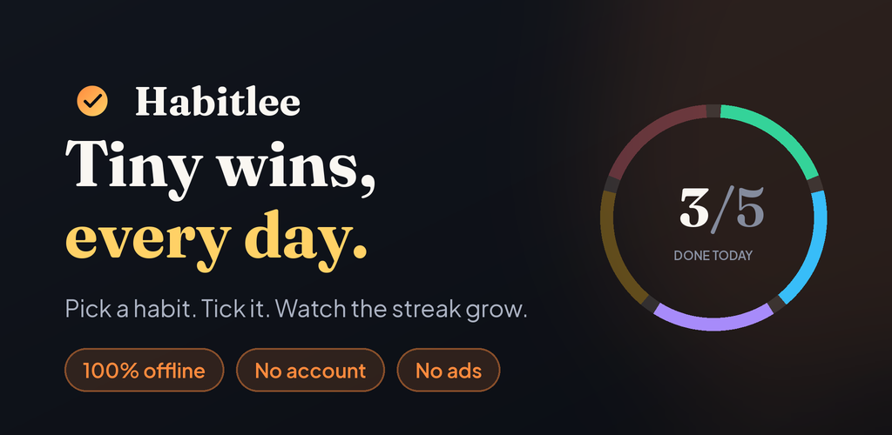
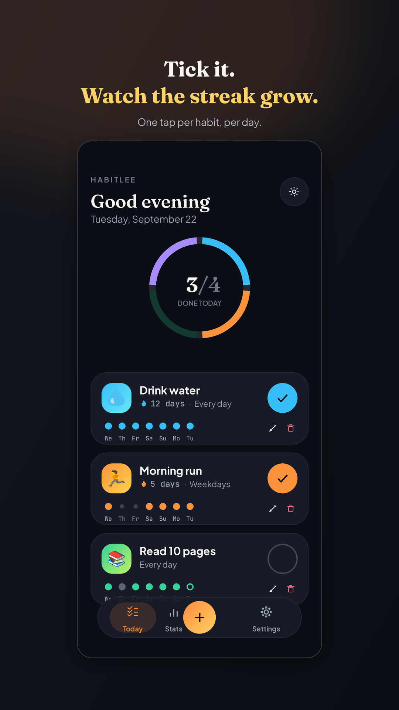
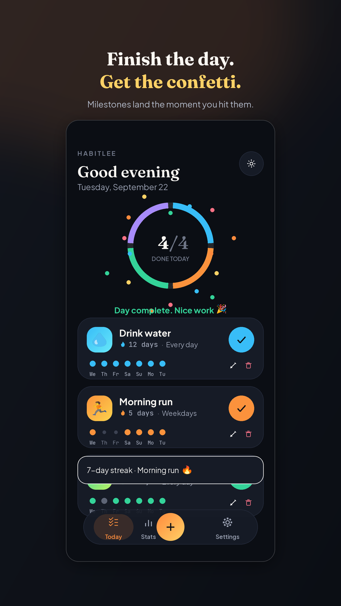
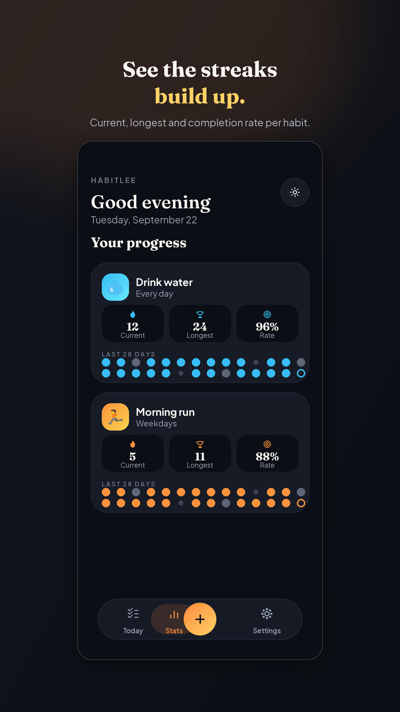
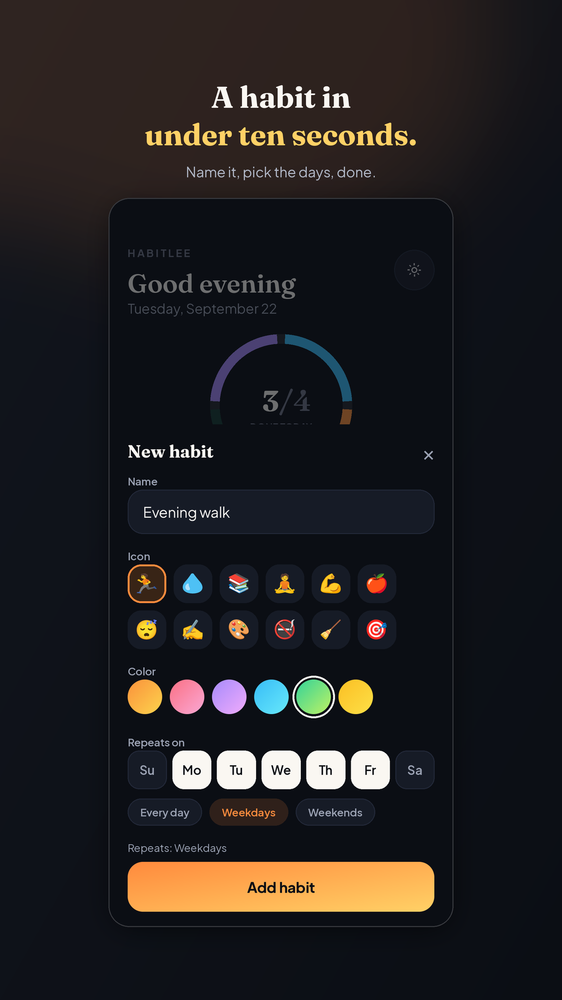
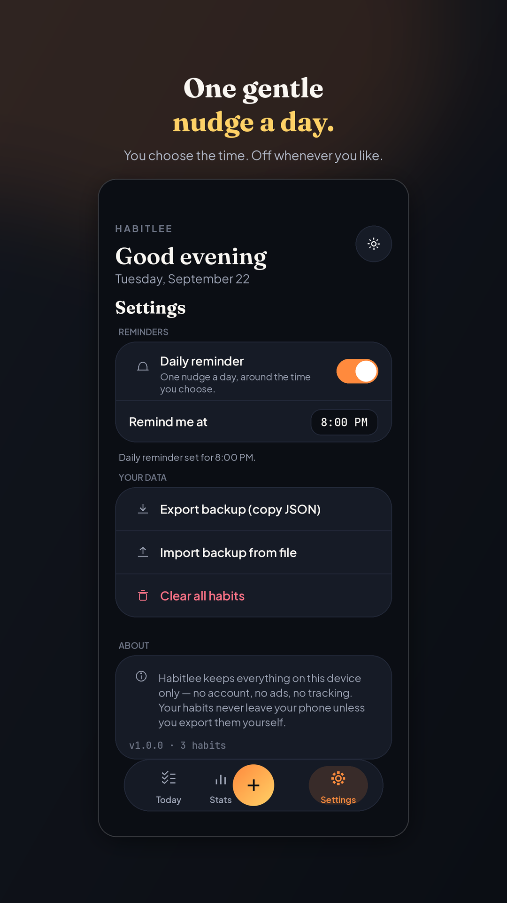

<p align="center">
  
</p>

<h1 align="center">Habitlee</h1>

<p align="center">
  <strong>A micro-habit tracker that respects your attention and your data.</strong><br />
  React + Vite + Tailwind, packaged for Android with Capacitor 8.
</p>

<p align="center">
  <a href="https://play.google.com/store/apps/details?id=com.habitlee.habittracker">
    
  </a>
</p>

<p align="center">
  
  
  
  
  
  
  
  
  
</p>

<p align="center">
  <em>100% offline &nbsp;•&nbsp; no accounts &nbsp;•&nbsp; no ads &nbsp;•&nbsp; no analytics &nbsp;•&nbsp; no network permission</em>
</p>

---

## Screenshots

<p align="center">
  
  
  
  
  
</p>

<p align="center">
  <sub>Today &nbsp;·&nbsp; Day complete &nbsp;·&nbsp; Stats &nbsp;·&nbsp; Add a habit &nbsp;·&nbsp; Settings</sub>
</p>

---

## Why it exists

Most habit trackers ask for an account, phone home with your behavioural data, and bury a simple daily checklist under subscriptions and streak-shaming. Habitlee does one thing: it shows you what's due today, lets you tick it in under a second, and shows the streak growing.

Every byte of data lives in `localStorage` on the device. There is no backend to breach, no account to delete, and no analytics SDK in the bundle. The app declares no `INTERNET` permission and ships with Android Auto Backup disabled — the privacy claim is enforced by the manifest, not just the marketing copy.

---

## Features

| | |
|---|---|
| **Flexible scheduling** | Every day, weekdays, weekends, or any custom day set |
| **Backfill** | Tap a past day in the trail to record a habit you forgot to tick |
| **Streaks & stats** | Current streak, longest streak, completion rate — computed, not estimated |
| **SparkTrail** | A per-habit week strip where the fill encodes history: done, due, missed, or not-yet-created |
| **Weekly calendar** | Stats shows each habit's last 28 days as a 7-column week grid, today in the bottom-right |
| **Daily reminder** | One opt-in local notification, inexact by design (no `SCHEDULE_EXACT_ALARM`) |
| **Celebration** | Confetti and milestone toasts at 3 / 7 / 14 / 30 / 60 / 100 / 200 / 365 days |
| **Undo** | Deleting a habit shows an undo toast that restores it at its original index |
| **Import / export** | Full JSON round-trip, with a confirm step before any destructive replace |
| **Dark & light** | System-aware, persisted, with the Android system bars recoloured to match |

---

## Engineering notes

A few decisions worth calling out:

- **Zero-dependency test suite.** 27 unit tests on `node:test` cover the date, streak and normalisation logic — the parts where an off-by-one silently corrupts a user's history. Run with `npm test`.
- **Defensive persistence.** Every read from `localStorage` is validated and normalised through `utils/habits.js`. A malformed import or a partially-written record degrades to a safe default instead of wiping the store.
- **Midnight correctness.** `useToday` re-derives the current local date on app resume and across midnight, so a session left open overnight doesn't tick yesterday's box.
- **Error boundaries.** App-level and per-view, so one bad render surfaces a recoverable message rather than a blank screen.
- **No exact alarms.** The reminder deliberately uses inexact scheduling. It can arrive a few seconds late; in exchange the app avoids a Play Store permission category that invites review friction for a habit tracker.
- **Static Capacitor imports.** Dynamic imports stall under Capacitor's `https://localhost` origin because Vite's modulepreload hints are served without CORS headers. All native imports are static and `build.modulePreload` is off.
- **Flicker-free delete dialog.** On Android's WebView the Framer Motion version of the confirm dialog flashed on open and close. It is now plain markup with one CSS keyframe (`fill-mode: both`) and no exit animation, which removed the flash on device.

---

## Tech stack

**Frontend** — React 18, Vite, Tailwind CSS, Framer Motion, lucide-react  
**Native shell** — Capacitor 8, `@capacitor/local-notifications`  
**Storage** — `localStorage`, no backend  
**Testing** — `node:test`  
**Build** — Gradle 8.14.3, AGP 8.13.0, JDK 21, target SDK 36 / min SDK 24

---

## Quick start

```bash
npm install
npm run dev     # web preview
npm test        # unit tests for the date/streak/normalisation logic
```

Open the printed `localhost` URL. The app is mobile-first — use your browser's device toolbar (e.g. Chrome DevTools → toggle device toolbar) to preview it at phone width.

Requires **Node.js 22+**. Android builds additionally need **JDK 21** and **Android Studio Otter (2025.2.1)+**.

### Android

```bash
npm run cap:sync    # build web assets + copy into the native project
npm run cap:open    # open android/ in Android Studio
```

Targets Android 16 (API 36), the level Google Play requires for new apps and updates as of 31 August 2026.

See `GUIDE.md` for the full path from here to a signed app installed on your phone and live on the Play Store.

---

## Project structure

```
src/
  App.jsx                    # tab routing + modal orchestration
  components/                # all UI pieces (see file names)
  hooks/useHabits.js         # localStorage-backed habit state + CRUD
  hooks/useTheme.js          # dark/light mode persistence + system bar colour
  hooks/useToday.js          # keeps "today" correct across midnight / app resume
  hooks/useBackDismiss.js    # Android back button closes the top overlay
  hooks/useReminder.js       # local notification scheduling + permission flow
  utils/dates.js             # local-date helpers, due-day logic
  utils/streak.js            # current/longest streak + completion rate math
  utils/habits.js            # validation + normalisation of every habit object
  utils/colors.js            # habit color palette + emoji set
  utils/haptics.js           # vibration feedback (no-op where unsupported)
tests/                       # node:test unit tests, zero dependencies
scripts/
  share-apk.js               # builds a debug APK + serves it via QR code
  check-version.js           # keeps package.json and build.gradle in lockstep
docs/                        # privacy policy, screenshots, store assets
```

---

## Privacy

Habitlee collects nothing, transmits nothing, and stores nothing off-device. Android Auto Backup is explicitly disabled so habit data never reaches Google Drive.

Full policy: **[tahmeedwolf.github.io/habitlee-app-privacy](https://tahmeedwolf.github.io/habitlee-app-privacy/)**

---

## Status

**Live on Google Play** — current version **1.0.3**. Package: `com.habitlee.habittracker`.

**[Get Habitlee on Google Play](https://play.google.com/store/apps/details?id=com.habitlee.habittracker)**

Before production, the app passed Google Play's 14-day closed test with three releases (1.0.1 → 1.0.3).

---

## Author

**Tahmeed Rahman** — software engineer, Dhaka, Bangladesh

[Portfolio](https://tahmeed-developer-portfolio.vercel.app/) · [GitHub](https://github.com/TahmeedWolf) · rahmantahmeed@gmail.com
